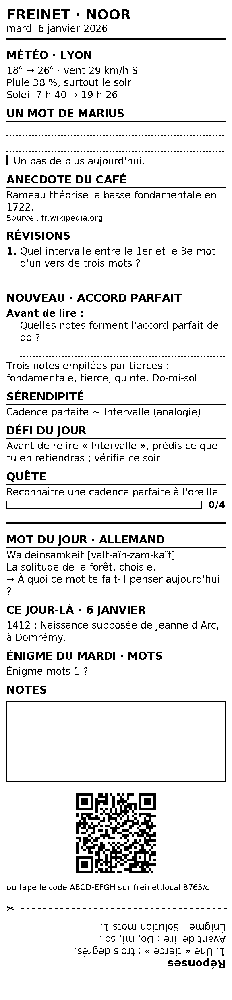
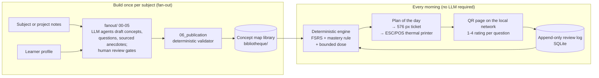
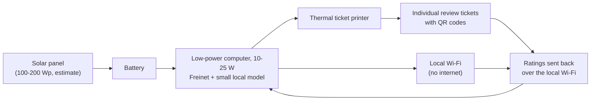

# Freinet

[](https://github.com/AnatolCombe/freinet/actions/workflows/ci.yml)
[](LICENSE)
[](pyproject.toml)

**A personal tutor that prints one short, verified lesson ticket every morning, and lets a deterministic spaced-repetition engine, not a language model, decide what you have learned.**

<p align="center">
  
</p>

<p align="center"><sub>A ticket produced by the code (576 px wide, 1-bit, for an 80 mm thermal printer), rendered by the test suite from the demo map and fictional learners. This one is in French; English-speaking learners get English labels (see <a href="#example-output">example output</a>).</sub></p>

---

## Why

Learning many subjects at once, over months, should not depend on daily willpower. Three problems motivate Freinet:

- **AI tutors answer, but they do not govern progress.** A chat model "feels" that the learner has understood. In a field experiment with high-school students, unrestricted access to a generative AI tutor improved practice scores but lowered performance once the AI was removed, while a version with safeguards largely avoided that harm (Bastani et al., *Generative AI without guardrails can harm learning*, PNAS, 2025). Freinet keeps the model on the content side and gives mastery and scheduling to a deterministic engine.
- **Motivation collapses after a broken streak.** Streak counters punish the people who most need a gentle restart. Freinet has no daily streak: it tracks a weekly goal (5 tickets out of 7), never counts an unrated question as a failure, and prints a soft restart ticket after a pause.
- **Screens compete for attention.** The daily ritual is a paper ticket read with morning coffee: one new notion, a few reviews, a challenge, the answers folded at the bottom. Feedback is one QR scan and a 1 to 4 rating per question.

## How it works



1. **Profile.** Each learner (a "BRAINIAC") has a private folder under `brainiacs/<learner>/` (git-ignored) and a few settings: time zone, display name, language (French or English).
2. **Fan-out.** A subject, or a course/research document from one of your projects, becomes a **concept map** of about 25 linked concepts: prerequisites, lateral "serendipity" links, quests, 4 to 6 typed questions per concept (recall, application, pitfall, transfer) and sourced anecdotes. Stages `00`-`05` are run by LLM agents in Claude Code with human review gates; their contracts are in `fanout/*/CONTEXT.md`.
3. **Publication.** `python -m freinet.publication` validates everything before it can reach a ticket: no prerequisite cycle, orphan concept or unknown id; every anecdote sourced against a per-domain registry of trusted sources; finance content sourced and carrying a disclaimer; text printable by the ticket font. Only then is the library swapped in atomically.
4. **Daily selection.** At 05:57 a scheduled job picks the day's items reproducibly (same seed and state, same plan): due reviews from FSRS, at most one new notion with a pre-test, a serendipity link, an anecdote, a challenge, quest progress. Weekends are all serendipity.
5. **Ticket.** The plan is rendered to a 1-bit PNG with an embedded font and a QR code, then printed over USB or Ethernet in raw ESC/POS, with the printer status checked before and the output confirmed after.
6. **Feedback.** The QR opens a page on the local network where the learner rates each question 1 to 4. Ratings are appended to a log; FSRS state and mastery are recomputed from that log, and tomorrow's ticket reflects them.

See [docs/architecture.md](docs/architecture.md) for modules, data flow and invariants.

## Design principles

- **The LLM generates, the engine governs.** Language models draft content during the fan-out. They never decide mastery or the review schedule. A concept is *acquired* when its FSRS-predicted retention 30 days out, without review, is at least 0.85 **and** at least one transfer question was answered well. The constants live in `_config/regle-acquis.md`; "acquired" never goes backwards.
- **The ticket prints without an LLM.** The only model call in the morning is an optional one-line coach sentence (`claude -p`), checked for length and printability, with a default sentence as fallback. The test suite runs with the LLM switched off.
- **Verified before printing.** Nothing is generated at print time: every lesson, question and anecdote went through the publication validator and a human gate first.
- **Local-first.** One SQLite file, plain Markdown content, a QR page served only to private network addresses. No account and no cloud service required. The only network call in the daily run is an optional weather lookup (Open-Meteo, no key) that fails silently.
- **Reproducible and auditable.** The review log is append-only (SQL triggers forbid UPDATE and DELETE); replaying it reproduces FSRS state and mastery exactly; selection is deterministic.
- **No punitive gamification.** No streaks, leaderboards or badges. A bounded dose (at most 5 reviews and 1 new notion per ticket, set in `_config/dose.md`) protects against both binging and burnout. An unrated question is never a failure.
- **No learning styles.** Freinet does not model "visual / auditory / kinesthetic" learners, a claim research does not support.

## Quickstart

Requires Python 3.11+ and [uv](https://docs.astral.sh/uv/). Run from a clone: the code reads `_config/` and `bibliotheque/` relative to the repository root.

```bash
git clone https://github.com/AnatolCombe/freinet.git && cd freinet
uv sync                                               # .venv with pinned dependencies
uv run pytest                                         # full suite, 85 % coverage gate
export FREINET_SANS_RESEAU=1 FREINET_SANS_LLM=1   # offline, no LLM
uv run python -m freinet.eleves ajouter demo Europe/Paris \
  && uv run python -m freinet.eleves inscrire demo harmonie-demo --quete entendre-une-cadence \
  && uv run python -m freinet.quotidien --eleve demo --sans-coach \
  && uv run python -m freinet.rendu --eleve demo
```

The last command writes `quotidien/03_rendu/output/demo/ticket-<date>.png` and `.txt` (both git-ignored) from the small demo map shipped in `bibliotheque/`. To print on an Epson TM-m30 family printer, set `_config/imprimante.md` and add `--imprimer`. To rate the ticket, start the QR page with `uv run python -m freinet.serveur`.

> The code base, CLI commands and configuration files use French identifiers (`eleves` = learners, `quotidien` = daily, `rendu` = rendering, `bibliotheque` = library). Learner-facing output exists in French and English.

## Example output

The 48-column text twin of a ticket for an English-speaking learner, generated by the test suite from the demo map (excerpt of `tests/ticket/reference/ticket-anglais.txt`). The labels are translated; the demo map only has a partial English overlay, so some content stays in French:

```text
FREINET · NOOR
Tuesday 6 January 2026
================================================

REVIEW
------
1. Quel intervalle entre le 1er et le 3e mot
   d'un vers de trois mots ?
   _____________________________________________

NEW · ACCORD PARFAIT
--------------------
Before reading : Quelles notes forment l'accord
   parfait de do ?
   _____________________________________________
Trois notes empilées par tierces : fondamentale,
tierce, quinte. Do-mi-sol.

SERENDIPITY
-----------
Cadence parfaite ~ Intervalle (analogy)

QUEST
-----
Reconnaître une cadence parfaite à l'oreille
░░░░░░░░░░░░░░░░░░░░ 0/4

RATE IT: scan the QR,
or type the code ABCD-EFGH at
freinet.local:8765/c

- - - - - - - ✂ fold here - - - - - - - - - - -
ANSWERS
1. Une « tierce » : trois degrés.
Before reading : Do, mi, sol.
```

## Project status

Freinet is **alpha software, used by its author**. It has not been evaluated in a study, and it has no external users or deployments.

**Works today (V0, covered by the test suite):**

- SQLite layer with an append-only review log, replay, migrations, consistent backups and restore checks
- FSRS scheduling per learner × concept (`fsrs` 6.3.2, fuzzing off) and the "acquired" rule
- Concept map, quest and question formats; graph validation; full-text search for concept reuse; Mermaid export
- Publication validator and atomic library swap; trusted-source registry
- Reproducible daily selection with bounded dose, pre-tests, serendipity, weekly goal, restart tickets and an "I already know this" joker
- Plan → 1-bit PNG ticket with QR code, folded answers and a general section (word of the day, on this day, puzzle, optional weather)
- ESC/POS printing over USB (pyusb) or TCP port 9100 with status checks
- QR feedback page and read-only course pages on the local network, with hashed per-ticket access tokens and short codes
- French and English learners
- Morning job, 07:00 heartbeat alert and launchd agents (macOS)
- An optional local JSON API (`/adviza/*`), off unless a token is configured, bound to 127.0.0.1, with one token per learner: it lets a separate front-end read a learner's day and send named, idempotent actions

**Planned:** the living learner profile and interview, the weekly coach, the Feynman "teach-back" mode, chat adapters, multi-learner hosting. See [docs/roadmap.md](docs/roadmap.md).

## Vision: a solar, offline cyberdeck for schools

> **Vision, planned. Nothing in this section has been built, piloted or tested.** It describes where the design choices above could lead.

Freinet's constraints (no LLM needed at print time, a local SQLite file, a QR page on a local network, paper as the learner's interface) are also the constraints of a school with no grid power and no internet. The planned direction is the **Freinet Box**: a small, low-power box for offline schools and learning centres, including in displacement settings.



- **Paper for pupils without phones.** A thermal printer produces individual daily review sheets; the spaced-repetition engine picks what each pupil should revisit. This is how Freinet already works for a single learner.
- **An assistant for the teacher, not the pupil.** A small local model helps prepare a lesson, an exercise or a test; the teacher always approves before use, as the human gates of the fan-out do today.
- **Knowledge that stays local.** Content validated by teachers joins a shared library; boxes exchange it by USB stick.
- **Guaranteed fallback.** If the model fails, the resources and printed sheets still work, as the ticket already prints without an LLM.

| Need | Candidate | Confidence |
|---|---|---|
| Computer for a 1-3 billion parameter model | Raspberry Pi 5 (8 GB), about 7-10 W | third-party tests |
| Computer for a ~7 billion parameter model | Jetson Orin Nano Super, 25 W | third-party tests |
| Solar autonomy for a day of use | 100-200 Wp kit with battery | estimate |
| Thermal ticket printer | Epson TM-m30 range | used by this project today |

Details and open questions: [docs/vision.md](docs/vision.md).

## Why the name

The project is named after Célestin Freinet (1896-1966), a French teacher who brought a printing press into his classroom. Three of his practices echo choices made here, at a much smaller scale:

- **The school printing press** (pupils printed their own texts) and the **ticket printed every morning**.
- **Inter-school correspondence** (classes exchanged their work by post) and the planned **boxes exchanging validated knowledge** by USB stick.
- **Experimental groping** (*tâtonnement expérimental*, learning at one's own pace through trial and error) and **progress at the learner's own rhythm, without a punitive streak**.

This project is not affiliated with the Freinet movement (ICEM, FIMEM).

## Repository layout

| Path | What it is |
|---|---|
| `freinet/` | the deterministic engine (Python package, one responsibility per file, at most 400 lines) |
| `migrations/` | SQL schema migrations |
| `fanout/` | the concept-map pipeline, one `CONTEXT.md` contract per stage |
| `quotidien/` | the daily pipeline: selection → plan → rendering → feedback |
| `bibliotheque/` | the shared content library (here: a small demo map) |
| `brainiacs/` | private learner records (only templates are versioned) |
| `_config/` | configuration read by the code: mastery constants, dose, printer, QR page, trusted sources, general-section lists |
| `scripts/` | end-to-end V0 check, index regeneration, stage-contract check, launchd installer |
| `tests/` | pytest suite: unit, property-based (Hypothesis), rendering references |

## Contributing

Contributions are welcome: see [CONTRIBUTING.md](CONTRIBUTING.md), [docs/good-first-issues.md](docs/good-first-issues.md) and the [Code of Conduct](CODE_OF_CONDUCT.md). To report a vulnerability, see [SECURITY.md](SECURITY.md).

## License

[Apache License 2.0](LICENSE). Copyright 2026 Marius Dissat. The embedded DejaVu fonts keep their own license (`freinet/polices/LICENSE_DEJAVU`); see [NOTICE](NOTICE).
